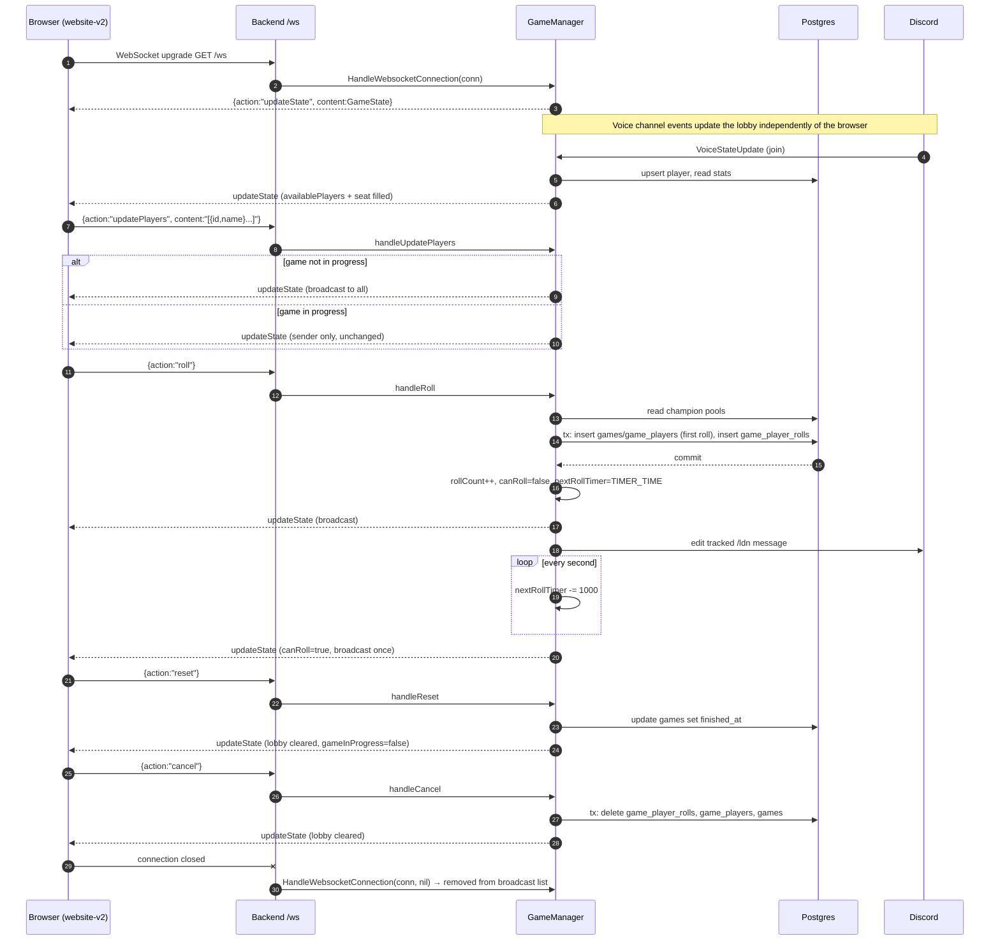

# bonjack-tools-backend-go

Backend for [bonjack-tools-website-v2](https://github.com/phturb/bonjack-tools-website-v2). It runs the Discord bot, the REST API and the websocket that drives the **Lois des Norms** lobby.

```sh
cp .env.example .env     # fill DISCORD_TOKEN, RIOT_API_KEY, database and JWT values
docker compose up -d     # postgres + adminer
go run .                 # listens on PORT (default 3001)
go test ./...
```

## Websocket contract

Endpoint: `ws://<host>/ws` (production `wss://tools.bonjack.club/ws/`). No authentication. The server holds a single global game state; every connected browser sees the same lobby.

### Envelope

Every frame in both directions is a JSON object:

```json
{ "action": "<string>", "content": "<string, optional>" }
```

`content` is itself a **JSON-encoded string**, not an object. Clients must `JSON.stringify` the payload before sending and `JSON.parse` it after receiving.

### Client → server actions

| `action` | `content` | Effect |
|---|---|---|
| `updatePlayers` | `[{ "id": "<discord id or empty>", "name"?: "<string>" }]`, at most 5 entries, index = seat | Re-seats the lobby. Ignored while a game is in progress (the server answers the sender with the current state). Unknown ids and duplicates become empty seats. `name` is ignored; the server uses the name it knows. |
| `roll` | none | Starts the game on the first call (creates the `games` row) and assigns a random role and champion to every seated player. Refused while `canRoll` is false. |
| `cancel` | none | Deletes the current game and its rolls from the database, then resets the lobby. |
| `reset` | none | Marks the current game finished (`finished_at`) and resets the lobby. The Discord button for this is labelled **Finish**. |
| `refreshDiscord` | none | Accepted, currently a no-op. |

Unknown actions are logged and dropped. The server never sends an error frame.

### Server → client action

| `action` | `content` |
|---|---|
| `updateState` | The full `GameState` below, JSON-encoded. |

`updateState` is sent to the new connection immediately after the upgrade, and broadcast to every connection whenever the state changes (seat change, roll, cancel, reset, player joining or leaving the voice channel, roll cooldown expiring).

### `GameState`

```jsonc
{
  "players": [                       // always 5 seats
    {
      "player":   { "id": "123", "name": "Alice" },   // id "" and name null for an empty seat
      "role":     "ADC" | "MID" | "JUNGLE" | "SUPPORT" | "TOP" | null,
      "champion": { "id": "266", "name": "Aatrox", "img": "Aatrox.png" } | null
    }
  ],
  "rollCount": 2,
  "gameInProgress": true,
  "availablePlayers": {              // everyone currently in the voice channel, keyed by discord id
    "123": {
      "id": "123",
      "name": "Alice",
      "stats": { "maxNumberOfRoll": 4, "numberOfGame": 12, "totalRoll": 31 }
    }
  },
  "gameId": 57,                      // 0 when no game is open
  "nextRollTimer": 287000,           // ms remaining before the next roll is allowed
  "canRoll": false,
  "discordGuild": "2123...",         // guild id
  "discordGuildName": "Bonjack",
  "discordGuildChannelId": "2123...",
  "discordGuildChannel": "General",  // channel name
  "leagueVersion": "14.21.1"
}
```

Notes for clients:

- `champion.img` is a file name. Build the icon URL as `https://ddragon.leagueoflegends.com/cdn/<leagueVersion>/img/champion/`.
- While a game is in progress, seated players are injected into `availablePlayers` even if they left the voice channel, so the seat select always has a matching option.
- `nextRollTimer` is relative to the moment the frame was sent. Convert it to an absolute deadline on receipt; the server does not broadcast every tick, only when `canRoll` flips back to true.
- The server does not send a frame when it refuses an action (`roll` during cooldown, `updatePlayers` during a game). The client keeps the last `updateState`.

### Sequence



Restart behaviour: on boot `bootstrap()` reloads the last game with `finished_at IS NULL` from the database and restores seats, roles and champions from its latest roll, so a deploy during a game does not lose it. The roll cooldown and the tracked Discord message are not persisted.

## REST API

| Method | Path | Auth | Notes |
|---|---|---|---|
| GET | `/api/healthz` | – | `{"ok":true}` |
| GET | `/api/players` | – | all known players |
| GET | `/api/games` | – | all games |
| GET | `/api/players/{id}/stats` | – | `404` for unknown player |
| GET | `/api/players/{id}/champions` | – | pool with `owned` flag; no rows stored means every champion is owned |
| POST | `/api/players/{id}/champions` | Bearer JWT (Auth0) | body `[{"id":"266","owned":true}]`; subject must be `oauth2|discord|{id}` |

JWT is enforced only when `JWT_SECRET` is set. CORS allows any origin with `Content-Type` and `Authorization` headers.
