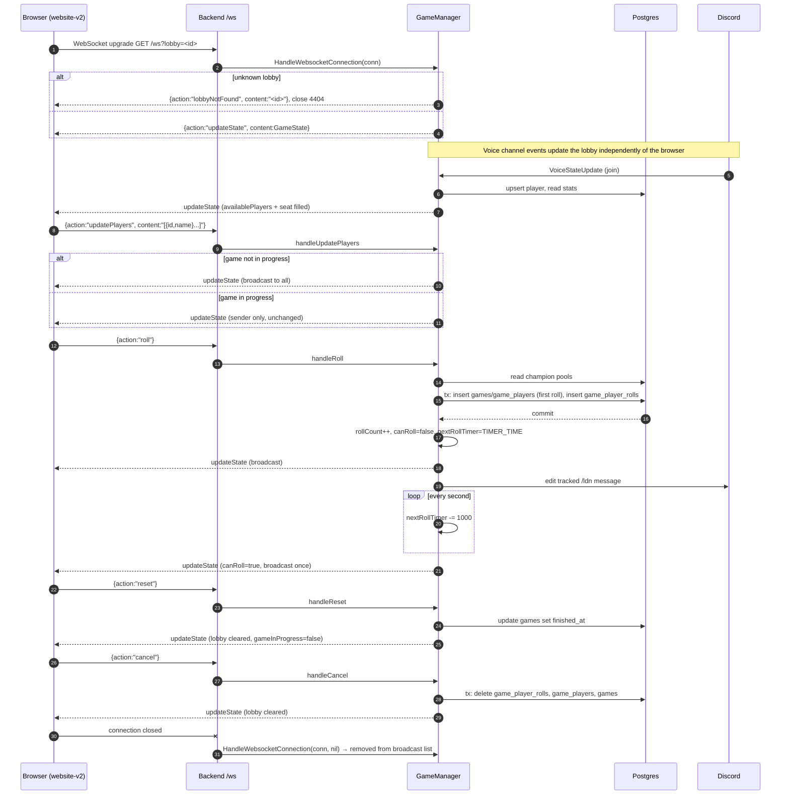

# bonjack-tools-backend-go

Backend for [bonjack-tools-website-v2](https://github.com/phturb/bonjack-tools-website-v2). It runs the Discord bot, the REST API and the websocket that drives the **Lois des Norms** lobbies.

```sh
cp .env.example .env     # fill DISCORD_TOKEN, RIOT_API_KEY, database and JWT values
docker compose up -d     # postgres + adminer
go run .                 # listens on PORT (default 3001)
go test ./...
```

## Websocket contract

Endpoint: `ws://<host>/ws?lobby=<id>` (production `wss://tools.bonjack.club/ws/`). No authentication.

Several lobbies run at once, each with its own seats, game, roll cooldown and Discord message. A connection subscribes to one lobby: the `lobby` query parameter names it, and a missing or empty `lobby` means `main`, the lobby that always exists (so a client that predates lobbies keeps working unchanged). An unknown id gets `lobbyNotFound`, then the server closes the connection with code `4404`. Every lobby seats players from the one configured voice channel, and a player sits in at most one lobby. Lobbies are listed, created and deleted through `/api/lois/lobbies` (see REST API).

### Envelope

Every frame in both directions is a JSON object:

```json
{ "action": "<string>", "content": "<string, optional>" }
```

`content` is itself a **JSON-encoded string**, not an object. Clients must `JSON.stringify` the payload before sending and `JSON.parse` it after receiving.

### Client → server actions

| `action` | `content` | Effect |
|---|---|---|
| `updatePlayers` | `[{ "id": "<discord id or empty>", "name"?: "<string>" }]`, at most 5 entries, index = seat | Re-seats the lobby. Ids not in the voice channel become empty seats, duplicates are dropped. `name` is ignored; the server uses the name it knows. A player seated in another lobby that is only waiting moves here (their old seat empties). Refused while this lobby has a game in progress, or when a player sits in another lobby that has one: the server then sends the true state back to the sender only, since clients apply the change optimistically. |
| `roll` | none | Starts the game on the first call (creates the `games` row) and assigns a random role and champion to every seated player. Refused while `canRoll` is false, and the first roll is refused when a seated player is in a game in another lobby. |
| `cancel` | none | Deletes the current game and its rolls from the database, then resets the lobby. |
| `reset` | none | Marks the current game finished (`finished_at`) and resets the lobby. The Discord button for this is labelled **Finish**. |
| `refreshDiscord` | none | Accepted, currently a no-op. |

Every action applies to the connection's lobby. Unknown actions are logged and dropped. The server never sends an error frame.

### Server → client actions

| `action` | `content` |
|---|---|
| `updateState` | The full `GameState` below, JSON-encoded. |
| `lobbyNotFound` | The requested lobby id, as is (not JSON-encoded). The server closes the connection with code `4404` right after. |
| `lobbyClosed` | The lobby id, as is (not JSON-encoded). Sent when the lobby is deleted; the server closes the connection with code `4410` right after. |

`updateState` is sent to the new connection immediately after the upgrade, and to every connection of a lobby whenever its state changes (seat change, roll, cancel, reset, player joining or leaving the voice channel, roll cooldown expiring). A seat change or a game starting or ending in one lobby also re-sends every other lobby its state, so the `seatedIn` markers stay current.

### `GameState`

```jsonc
{
  "players": [                       // always 5 seats
    {
      "player":   { "id": "123", "name": "Alice" },   // id "" and name null for an empty seat
      "role":     "ADC" | "MID" | "JUNGLE" | "SUPPORT" | "TOP" | null,
      "champion": { "id": "266", "name": "Aatrox", "img": "Aatrox.png" } | null
    }
  ],
  "rollCount": 2,
  "gameInProgress": true,
  "availablePlayers": {              // everyone currently in the voice channel, keyed by discord id
    "123": {
      "id": "123",
      "name": "Alice",
      "stats": { "maxNumberOfRoll": 4, "numberOfGame": 12, "totalRoll": 31 }
    }
  },
  "gameId": 57,                      // 0 when no game is open
  "nextRollTimer": 287000,           // ms remaining before the next roll is allowed
  "canRoll": false,
  "discordGuild": "2123...",         // guild id
  "discordGuildName": "Bonjack",
  "discordGuildChannelId": "2123...",
  "discordGuildChannel": "General",  // channel name
  "leagueVersion": "14.21.1",
  "lobbyId": "main",                 // the lobby this state belongs to
  "lobbyName": "Main"
}
```

An entry of `availablePlayers` also carries `"seatedIn": { "id": "k3v9q2xa", "name": "Lobby 2", "gameInProgress": false }` when that player sits in another lobby. With `gameInProgress` true they can't be seated here; otherwise seating them here moves them.

Notes for clients:

- `champion.img` is a file name. Build the icon URL as `https://ddragon.leagueoflegends.com/cdn/<leagueVersion>/img/champion/`.
- While a game is in progress, seated players are injected into `availablePlayers` even if they left the voice channel, so the seat select always has a matching option.
- `nextRollTimer` is relative to the moment the frame was sent. Convert it to an absolute deadline on receipt; the server does not broadcast every tick, only when `canRoll` flips back to true.
- A refused `updatePlayers` is answered with the true state, to the sender only. Other refused actions (`roll` during cooldown) get no frame; the client keeps the last `updateState`.

### Sequence



Restart behaviour: lobbies live in memory. On boot `bootstrap()` restores every game with `finished_at IS NULL` whose last roll is less than 6 hours old, with the seats, roles and champions of its latest roll: the newest into `main`, each other one into its own lobby named `Restored game #<gameId>`. When two of them share a player, only the newer comes back. Every other unfinished game is marked finished. The roll cooldown and the tracked Discord messages are not persisted.

Discord: `/ldn` posts the message of the lobby the invoking user sits in, or of `main`. The message names the lobby and links to `https://tools.bonjack.club/lois-des-norms/<id>`; its buttons act on that lobby. The voice channel joins seat a player in `main` only (when main has no game and they sit nowhere); leaving the channel unseats them from every lobby without a game in progress.

## REST API

| Method | Path | Auth | Notes |
|---|---|---|---|
| GET | `/api/healthz` | – | `{"ok":true}` |
| GET | `/api/players` | – | all known players |
| GET | `/api/games` | – | all games |
| GET | `/api/players/{id}/stats` | – | `404` for unknown player |
| GET | `/api/players/{id}/champions` | – | pool with `owned` flag; no rows stored means every champion is owned |
| POST | `/api/players/{id}/champions` | Bearer JWT (Auth0) | body `[{"id":"266","owned":true}]`; subject must be `oauth2|discord|{id}` |
| GET | `/api/lois/lobbies` | – | `[LobbySummary]`: `main` first, then by `createdAt` |
| POST | `/api/lois/lobbies` | – | body `{"name"?: string}` (optional; trimmed, cut to 40 characters, default `Lobby N`); `201 LobbySummary`; `409` when 10 lobbies are open |
| DELETE | `/api/lois/lobbies/{id}` | – | `204`; `404` unknown id; `409` for `main` or a lobby with a game in progress. Its clients get `lobbyClosed` |

`LobbySummary` is `{ "id", "name", "isDefault", "gameInProgress", "rollCount", "gameId", "players": [{ "id", "name"? }], "viewers", "createdAt" }`: `id` is `main` or 8 characters `[a-z0-9]`, `players` lists occupied seats only, `viewers` counts open websocket connections, `createdAt` is RFC 3339. A lobby other than `main` is removed after 30 minutes with no game and no seated player; clients watching it don't keep it open and get `lobbyClosed`, as for a `DELETE`. Errors are `{ "error": "message" }`.

JWT is enforced only when `JWT_SECRET` is set. CORS allows any origin with `Content-Type` and `Authorization` headers.

## Swiss tournament API

Swiss-system tournaments between individual players, spec in `bonjack-tools-website-v2/docs/specs/swiss-tournament.md`. Reads are public. Every mutation requires a Bearer JWT (when `JWT_SECRET` is set) and is restricted to the creator: the token `sub` is stored as `ownerSub` at creation and compared on each call (`403` otherwise). Without JWT configured (local development, `go run ./cmd/swissdev`) the caller identity is the raw `Authorization: Bearer <subject>` value, or `dev` when no token is sent; this lets a local frontend act as the owner or as a stranger without Auth0. Errors are `{ "error": "message" }`.

| Method | Path | Body | Result |
|---|---|---|---|
| GET | `/api/swiss` | – | `[TournamentSummary]`: public tournaments, newest first |
| POST | `/api/swiss` | `TournamentConfig` | `Tournament`, `201` |
| GET | `/api/swiss/{id}` | – | `Tournament` with participants, rounds, matches, standings |
| PATCH | `/api/swiss/{id}` | partial `TournamentConfig` | `Tournament`; after start only `name` and `description` may change (`409`) |
| DELETE | `/api/swiss/{id}` | – | `204` |
| GET | `/api/swiss/players` | – | `[{ id, name }]`: known site users (Discord ids) for linking seats |
| PUT | `/api/swiss/{id}/participants` | `[{ "id"?, "name", "seed", "playerId"? }]` | `Tournament`; full replace, draft only, seeds renumbered 1..n; `playerId` must be a known player (`422`), unique per tournament |
| POST | `/api/swiss/{id}/participants/{pid}/claim` | – | `Tournament`; any logged-in Discord user links the seat to themselves (creates the player row if unknown); `409` when the seat is taken or the caller holds another seat, `403` without a Discord identity; allowed in every status, finished included |
| DELETE | `/api/swiss/{id}/participants/{pid}/claim` | – | `Tournament`; unlink, creator or the linked user only (`403`) |
| POST | `/api/swiss/{id}/participants/{pid}/drop` | – | `Tournament`; in progress only, forfeits the unplayed current match |
| POST | `/api/swiss/{id}/start` | – | `Tournament`; needs 2+ participants, applies seeding, generates round 1 |
| PUT | `/api/swiss/{id}/matches/{mid}/result` | `{ "p1Score", "p2Score" }` | `Tournament`; current round only, scores must form a valid best-of winner (`422`) |
| POST | `/api/swiss/{id}/rounds/close` | – | `Tournament`; every current match resolved, then next round; the Swiss stage ends as `completed`, the playoffs as `finished` |
| POST | `/api/swiss/{id}/playoffs/start` | – | `Tournament`; `completed` only, needs 2+ advanced participants; single-elimination round 1 seeded by the standings (`playoffsBestOf`, byes for top seeds), status `playoffs` |
| POST | `/api/swiss/{id}/rounds/undo` | – | `Tournament`; in progress only, removes the latest round when it has no result (`409` otherwise) |

`TournamentConfig` is flat: `{ "name", "description", "winsToAdvance", "lossesToEliminate", "bestOf", "decidersBestOf", "seeding", "allowRematches", "visibility" }`. Defaults: 3 / 3 / 1, `decidersBestOf` = `bestOf`, `manual`, `false`, `public`.

`TournamentSummary` is `{ "id", "name", "status", "participants", "createdAt" }` where `participants` is the participant count.

Wins, losses, Buchholz, participant status and standings are derived from the match rows on every read. Pairing is deterministic: buckets by record, Buchholz then seed inside a bucket, top half vs bottom half with rematch avoidance, floaters for odd buckets, one bye per participant per tournament, `decidersBestOf` for matches where a participant is one result from advancing or elimination. Random seeding uses the `rng_seed` stored at creation.
